<div align="center">



<h1>nmap Visual</h1>

<p><b>Una interfaz grafica local para usar nmap sin pelearte con la terminal.</b><br>
Plantillas de escaneo, resultados en vivo, grafo de la red y diagnostico con arreglos sugeridos.</p>


</div>

---

## Que es

nmap Visual envuelve a nmap en una pagina web que corre en tu propio equipo. No espera a
que termine el escaneo: pinta los hosts, los puertos y los servicios a medida que nmap
los va descubriendo. Pensada para que ver tu red sea tan facil como pulsar un boton, sin
renunciar a la potencia de nmap por debajo.

Todo ocurre en local. No hay servidores externos, ni cuentas, ni telemetria: el servidor
web vive en tu maquina y se apaga cuando tu quieras.

## Caracteristicas

| | |
|---|---|
| **Resultados en vivo** | Los equipos y puertos aparecen segun nmap los encuentra, con barra de progreso y registro en tiempo real. |
| **Escanea mi red** | Detecta tu subred local y lista todos los dispositivos, incluidos los que no responden al ping, con IP, MAC y fabricante. |
| **Grafo de la red** | Dibuja los equipos encontrados alrededor de la puerta de enlace y resalta los que conviene revisar. |
| **Plantillas listas** | Mapa de red, escaneo rapido, intenso, conexion TCP sin privilegios, UDP comunes y mas. Tambien puedes guardar las tuyas. |
| **Diagnostico con arreglos** | Cuando nmap falla por un motivo conocido, lo explica y ofrece un boton para aplicar los argumentos corregidos y reintentar. |
| **Catalogo de banderas** | Referencia buscable de las opciones de nmap por categoria, en espanol; pulsa una y se anade al comando. |
| **Catalogo de puertos** | Que corre en cada puerto, por que vigilarlo, como asegurarlo y que scripts NSE usar. |
| **Catalogo de comandos** | Mas de 900 comandos de terminal de Linux, macOS y Windows con sintaxis, ejemplo y categoria. |
| **Comparar escaneos** | Enfrenta dos escaneos y ve que puertos y equipos aparecieron o desaparecieron. |
| **Historial y descargas** | Cada escaneo se guarda y se puede reabrir o descargar en XML, texto normal y grepable. |

## Requisitos

- Windows, Linux o macOS.
- nmap instalado (en Windows, desde [nmap.org](https://nmap.org/download.html), que incluye Npcap).
- Python 3.8 o superior.

No hay dependencias externas: la herramienta usa solo la libreria estandar de Python, asi
que no necesita pip ni conexion a internet para instalarse.

En Windows, nmap suele quedar en `C:\Program Files (x86)\Nmap\nmap.exe` y la app lo detecta
sola. Si esta en otra ruta, define la variable de entorno `NMAP_PATH` con la ruta completa
al ejecutable.

## Como arrancar

Sin instalar nada, desde la raiz del proyecto:

```bash
python backend/app.py
```

Se abre en el navegador. Para detener el servidor, usa el boton "Apagar servidor" de la
barra lateral.

En Windows puedes crear un acceso directo que abre la app sin ventana de consola (una sola vez):

```powershell
./crear-acceso-directo.ps1
```

Despues basta con doble clic en el acceso directo "nmap Visual" del Escritorio. Si lo
pulsas de nuevo mientras ya esta abierta, solo abre otra pestana.

## Uso

1. Escribe el objetivo: una IP, un rango (`10.0.0.1-50`), una red (`192.168.1.0/24`) o un nombre de host.
2. Elige una plantilla o escribe tus propios argumentos de nmap.
3. Pulsa Iniciar. Los resultados aparecen en vivo.

El panel lateral muestra el estado del entorno (nmap, privilegios de administrador, Npcap),
un diagnostico con sugerencias cuando algo falla y el registro en tiempo real.

### Descubrir todos los dispositivos de la red

El boton "Escanear mi red" detecta tu subred local y lanza un mapa que lista todos los
equipos conectados, incluidos los que no responden al ping. En la red local nmap usa ARP,
que no se puede bloquear a nivel de enlace, por lo que aparecen tambien los dispositivos
"ocultos" tras un firewall. De cada host se muestra su IP, su direccion MAC y el fabricante
del adaptador, lo que ayuda a identificar que es cada dispositivo. Esta funcion da mejores
resultados ejecutando la app como administrador.

### Plantillas incluidas

- **Mapa de red**: descubre todos los dispositivos (incluidos los ocultos) con IP, MAC y fabricante.
- **Mapa de red profundo**: multiples sondas para sacar a la luz hosts tras firewalls.
- **Mapa de red con identificacion**: anade scripts para mas pistas de identificacion.
- **Escaneo rapido**: puertos mas comunes.
- **Rapido con servicios**: anade deteccion de versiones.
- **Intenso**: servicios, SO y scripts por defecto (necesita administrador).
- **Intenso sin ping** e **intenso todos los puertos TCP**: variantes para casos exigentes.
- **Descubrir hosts**: lista equipos activos sin escanear puertos.
- **Conexion TCP**: funciona sin privilegios de administrador.
- UDP comunes, deteccion con scripts seguros y escaneo normal.

Las plantillas marcadas como `(admin)` usan tecnicas que en Windows requieren Npcap y
ejecutar la app como administrador. Si no tienes privilegios, usa la plantilla de conexion
TCP, que logra resultados equivalentes para muchos casos.

### Archivos de salida

Cada escaneo guarda sus resultados en la carpeta `scans/` en los tres formatos de nmap (XML,
texto normal y grepable). Se pueden descargar desde la interfaz y el historial lateral
permite volver a abrir escaneos anteriores.

## Estructura del proyecto

```
nmapVisual/
  backend/
    app.py          servidor HTTP y eventos en vivo (SSE), solo stdlib
    scanner.py      ejecuta nmap y procesa su salida
    nmap_utils.py   deteccion del entorno, red local y utilidades
  frontend/
    index.html      interfaz
    app.js          logica de la interfaz
    styles.css      tema oscuro
    ports.js        catalogo de puertos y riesgos
    commands.js     catalogo de comandos de terminal
  scans/            resultados de cada escaneo (no se versionan)
  start.ps1
  crear-acceso-directo.ps1
```

## Privacidad

La herramienta no envia nada a ningun sitio: el servidor es local y los resultados se
guardan solo en tu equipo, en la carpeta `scans/`, que queda fuera del control de versiones.

## Aviso legal

Usa esta herramienta solo sobre redes y equipos propios o para los que tengas autorizacion
expresa. El escaneo de sistemas ajenos sin permiso puede ser ilegal.
